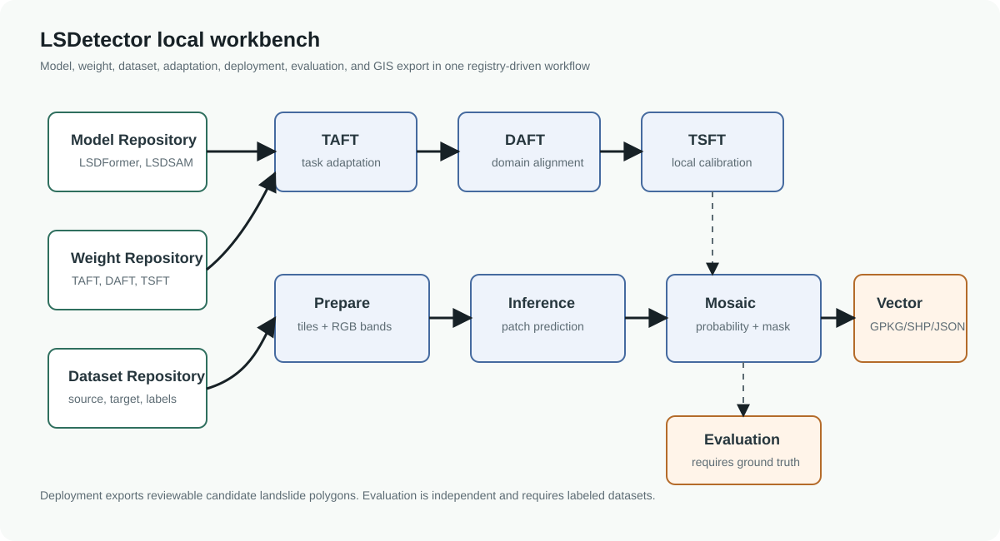
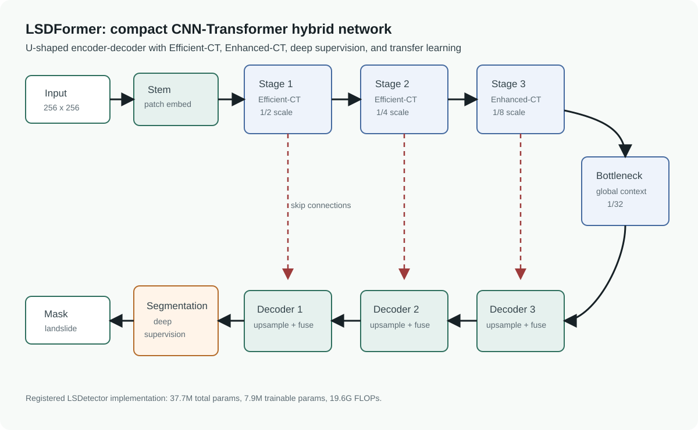
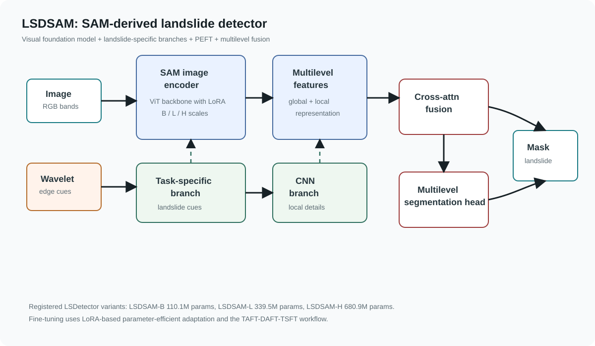
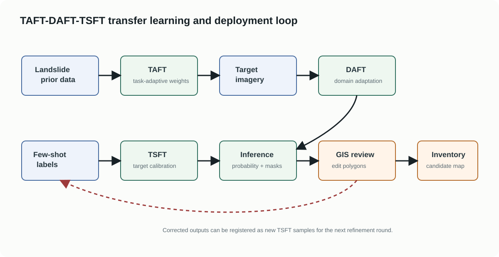
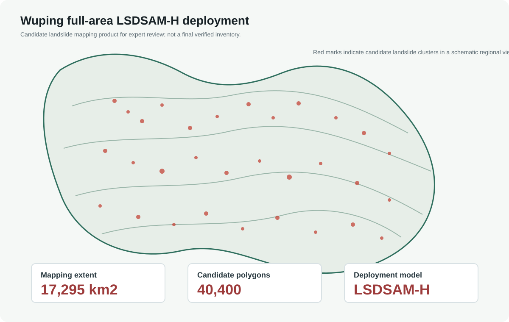

# LSDetector

**LSDetector** is a local AI-assisted workbench for regional landslide detection, transfer learning, deployment inference, evaluation, and GIS-compatible inventory production. It is prepared as the software link for the ISGDR conference paper and as the toolized implementation of two peer-reviewed landslide detection model families:

- **LSDFormer**: a compact CNN-Transformer hybrid network for efficient cross-region landslide detection by transfer learning.
- **LSDSAM**: a visual-foundation-model-based landslide detection framework that adapts SAM with enhanced three-stage transfer learning.

> **Use restriction:** LSDetector is released for academic research, education, review, and non-commercial use only. Commercial deployment, resale, closed-source commercial integration, or service commercialization is not permitted without written authorization from the authors.

[Documentation site](https://klaus2023.github.io/LSDetector/) | [Usage guide](docs/usage.md) | [Model details](docs/models.md) | [Wuping case](docs/wuping_case.md) | [License](LICENSE-NC.md)

## Overview

LSDetector bridges model research and practical landslide mapping. It packages model selection, weight registration, dataset registration, domain adaptation, target-specific fine-tuning, inference, evaluation, and GIS-compatible export into a reproducible local workflow.

The software is designed for practical scenarios where a target region has limited local labels, different image conditions, and a need for reviewable regional landslide inventories. It follows a registry-driven workflow around three asset repositories:

- **Model Repository**: LSDFormer and LSDSAM model families.
- **Weight Repository**: TAFT, DAFT, TSFT, and inference-ready checkpoints.
- **Dataset Repository**: source-domain, target-domain, local annotation, and evaluation datasets.



## Relationship To The Papers

LSDetector is the implementation and deployment workbench built around the following model papers.

| Component | Paper role | LSDetector role |
|---|---|---|
| LSDFormer | Efficient CNN-Transformer model for cross-region landslide detection | Lightweight and fast deployment model |
| LSDSAM-B/L/H | SAM-based foundation-model branch with enhanced transfer learning | High-capacity few-shot and practical deployment models |
| TAFT-DAFT-TSFT | Three-stage transfer-learning strategy | Configurable adaptation workflow for target regions |

## Model Zoo

| Model | Input | Total params | Trainable params | FLOPs | Recommended use |
|---|---:|---:|---:|---:|---|
| LSDFormer | 256 x 256 | 37.7M | 7.9M | 19.6G | Lightweight and fast regional deployment |
| LSDSAM-B | 512 x 512 | 110.1M | 13.5M | 261.6G | Balanced foundation-model deployment |
| LSDSAM-L | 512 x 512 | 339.5M | 17.4M | 840.3G | Higher-capacity mapping when GPU memory allows |
| LSDSAM-H | 512 x 512 | 680.9M | 21.6M | 1704.4G | Highest-capacity LSDetector model and Wuping deployment case |

The parameter and FLOP values refer to the registered LSDetector implementation used in the ISGDR software paper.

## Model Architectures

### LSDFormer

LSDFormer adopts a compact U-shaped encoder-decoder architecture. It combines convolutional inductive bias with Transformer-style global context modeling, allowing the model to capture local landslide boundaries and broader spatial dependencies while keeping computational cost relatively low.

Key components include:

- **Efficient-CT block**: combines MobileNetV3-style convolution with efficient multi-head self-attention.
- **Enhanced-CT block**: introduces involution-based spatial attention to strengthen spatially adaptive representation.
- **Deep supervision**: improves multi-scale decoder learning and segmentation stability.



### LSDSAM

LSDSAM adapts the Segment Anything Model to landslide detection. It removes the dependence on manual prompts for practical remote-sensing deployment and introduces landslide-specific adaptation branches for boundary and local feature learning.

Key components include:

- **SAM visual backbone** for transferable foundation-model representation.
- **Task-specific branch** for landslide edge and task cues.
- **CNN branch** for local detail and boundary information.
- **Multilevel cross-attention fusion and segmentation head** for multi-scale prediction.
- **LoRA-based PEFT** for efficient few-shot transfer.



## Three-stage Transfer Learning

LSDetector uses a staged adaptation strategy derived from LSDSAM and generalized to the embedded LSDFormer and LSDSAM model families.



| Stage | Full name | Purpose | User-side role |
|---|---|---|---|
| TAFT | Task-adaptive fine-tuning | Inject landslide-specific prior knowledge from large source-domain datasets | Usually provided as prepared starting weights |
| DAFT | Domain-adversarial fine-tuning | Reduce sensor, illumination, land-cover, and geomorphic domain shifts | Optional adaptation with target-domain imagery |
| TSFT | Target-specific fine-tuning | Calibrate the model with local annotations or corrected outputs | Final few-shot refinement before deployment |

## Wuping Deployment Case

In the ISGDR demonstration, LSDSAM-H was applied to large-area rainfall-triggered landslide mapping in Wuping. The deployment covered **17,295 km2** of PlanetScope imagery and produced **40,400 candidate landslide polygons** after two rounds of AI-assisted refinement.

These products are intended as candidate inventories for expert review and GIS editing. They should not be treated as fully verified landslide inventories without manual checking or additional refinement.



## Installation

The public documentation is prepared in this repository. The executable software package, trained weights, and third-party datasets should be distributed through controlled release channels with their own provenance, checksums, and license notes.

A typical local installation workflow is:

```bash
# 1. Clone the repository or obtain the permitted source package
git clone https://github.com/klaus2023/LSDetector.git
cd LSDetector

# 2. Create the recommended environment when the software package is available
conda env create -f environment.yml
conda activate lsdector

# 3. Start the local workbench
bash tools/start_lsd_app.sh
```

Then open:

```text
http://127.0.0.1:8501
```

CLI-style execution follows the same asset registry concept:

```bash
python -m lsd_app.cli.main --help
python -m lsd_app.cli.main run --config path/to/task.yaml --model lsdsam
```

## Basic Workflow

1. Register a model and its permitted checkpoint in the **Model Repository** and **Weight Repository**.
2. Register source, target, local annotation, or evaluation datasets in the **Dataset Repository**.
3. Use **DAFT** when target-domain imagery is available and domain alignment is needed.
4. Use **TSFT** when local labels or corrected model outputs are available.
5. Run **Inference** to generate probability rasters, binary masks, and vectorized landslide polygons.
6. Export `GPKG`, `SHP`, or `GeoJSON` products for manual review in ArcGIS, ArcGIS Pro, or QGIS.

See [docs/usage.md](docs/usage.md) for the full hyperparameter guide.

## Citation Requirement

If you use LSDetector, LSDFormer, LSDSAM, their model weights, or software outputs in a publication, report, thesis, conference paper, benchmark, or derivative product, you must cite the corresponding model paper(s).

Use LSDFormer citation when using the LSDFormer model family:

```bibtex
@article{fuCNNTransformerHybrid2026,
  title = {A CNN-Transformer Hybrid Network for Efficient Cross-Region Landslide Detection by Transfer Learning},
  author = {Fu, Zijin and Wang, Fawu and Zhong, Junfei and Catani, Filippo and Dou, Jie and You, Qi and Zhang, Bo},
  journal = {Landslides},
  year = {2026},
  doi = {10.1007/s10346-026-02733-w}
}
```

Use LSDSAM citation when using LSDSAM-B, LSDSAM-L, LSDSAM-H, or the three-stage LSDSAM transfer-learning framework:

```bibtex
@article{fuLSDSAMHarnessingVisual2026,
  title = {LSDSAM: Harnessing Visual Foundation Model and Enhanced Transfer Learning Towards Practical Landslide Detection in Few-shot Scenarios},
  author = {Fu, Zijin and Wang, Fawu and Tu, Zihan and Peng, Xingliang and Liu, Guanting and Catani, Filippo},
  journal = {IEEE Journal of Selected Topics in Applied Earth Observations and Remote Sensing},
  year = {2026},
  url = {https://ieeexplore.ieee.org/abstract/document/11456795/}
}
```

## Funding

This work was supported by the National Science Foundation of China under Grant No. **42230715** and No. **W2511039**.

## License

LSDetector is provided under an academic non-commercial source-available license. See [LICENSE-NC.md](LICENSE-NC.md). This repository is not licensed for commercial use.
