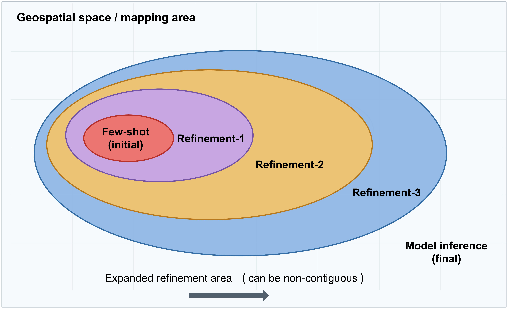
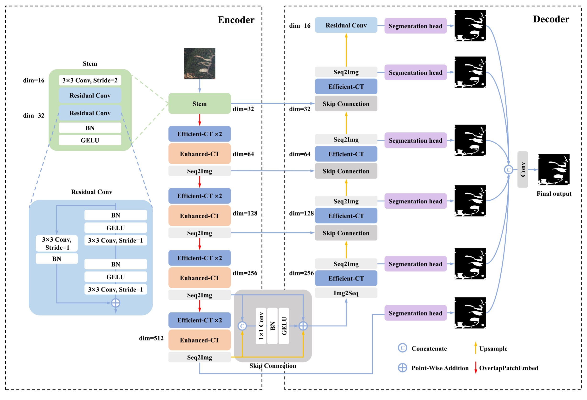
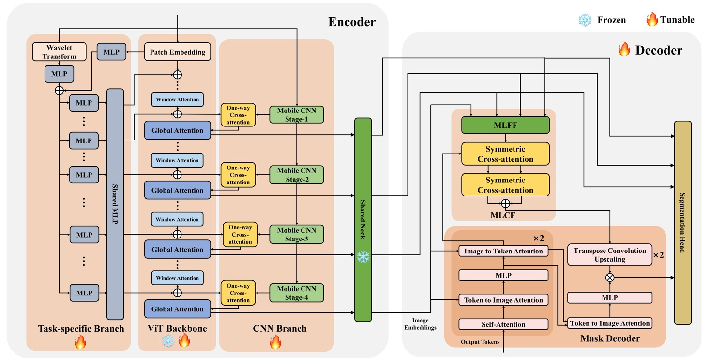
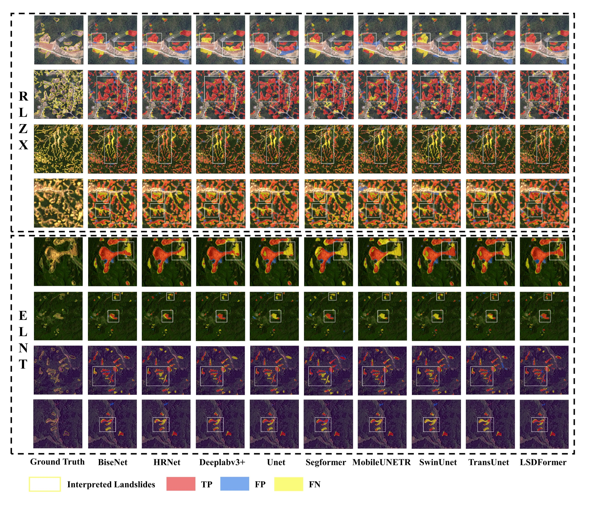
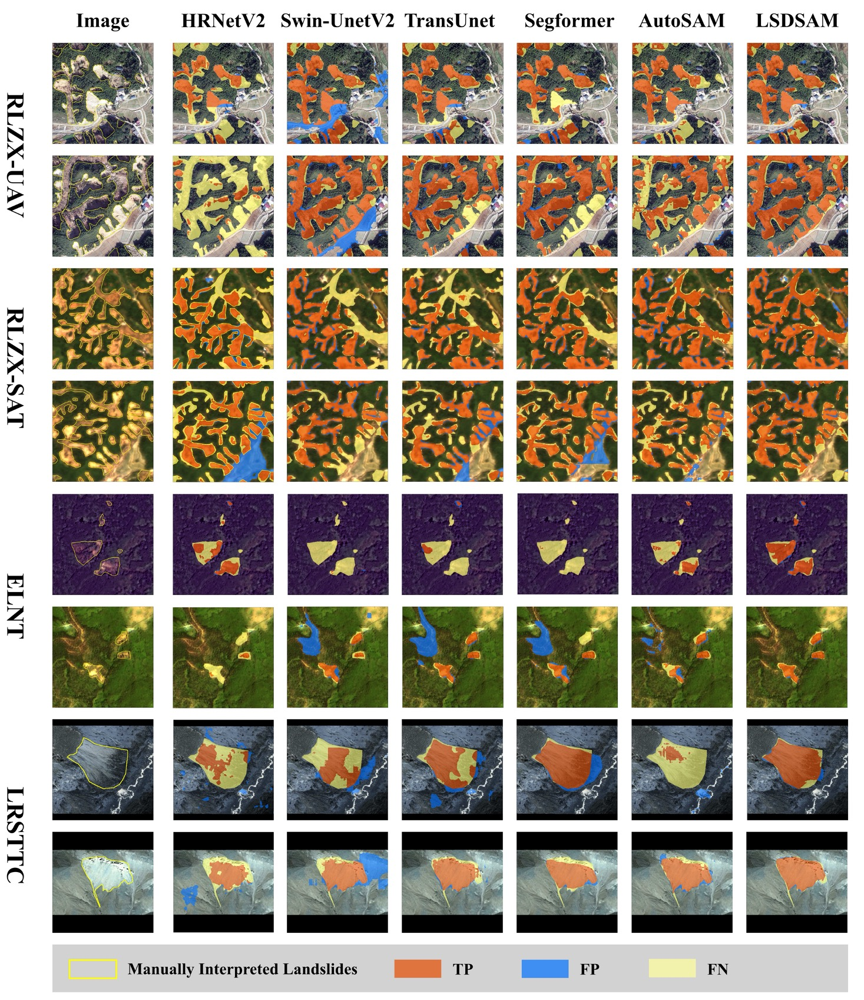
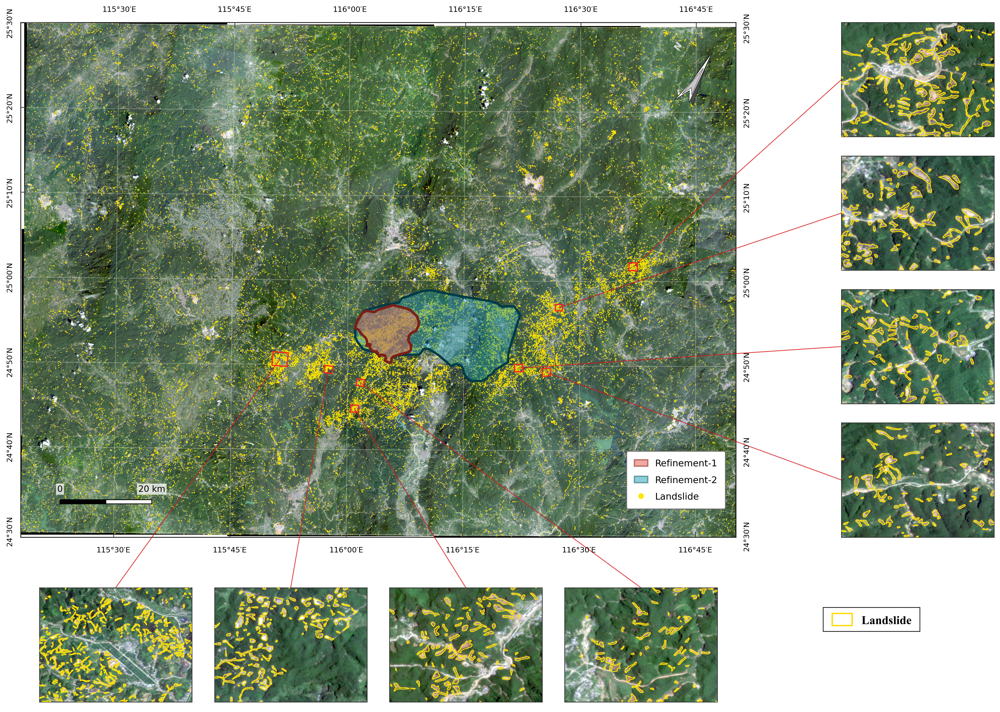

# LSDetector

**LSDetector: An Open-Source Tool Bridging Landslide Detection Models and Real-World Deployment through Three-Stage Transfer Learning**

<p align="justify">LSDetector is a scientific landslide-detection workbench prepared for the <strong>1st World Congress of the International Consortium on Geo-disaster Reduction (ICGdR) / International Symposium on Geo-disaster Reduction (ISGDR)</strong>, Hong Kong, China, 9-12 August 2026. The software is designed as the implementation, integration, and practical deployment tool for the <strong>LSDFormer</strong> and <strong>LSDSAM</strong> model families.</p>

> **Important:** LSDetector is provided only for scientific research, academic education, conference demonstration, and non-commercial applications. Commercial use is prohibited without written permission from the authors.

## 1. Related Papers

<p align="justify">This repository is associated with the LSDetector conference software description and two peer-reviewed model papers: one CNN-Transformer model and one foundation-model-based landslide detection model.</p>

### 1.1 LSDetector conference software paper

<p align="justify">This repository serves as the software landing page for the LSDetector full paper prepared for the first ICGdR / ISGDR World Congress:</p>

> Fu, Z., Meena, S. R., Catani, F., Luo, S., & Wang, F. (2026). **LSDetector: An Open-Source Tool Bridging Landslide Detection Models and Real-World Deployment through Three-Stage Transfer Learning**. In *1st World Congress of ICGdR / ISGDR*, 9-12 August 2026, Hong Kong, China.

<p align="justify">The LSDetector conference paper presents the software architecture, registry-based model, weight, and dataset management, the task-adaptive fine-tuning (TAFT), domain-adversarial fine-tuning (DAFT), and target-specific fine-tuning (TSFT) deployment workflow, model complexity analysis, and the Wuping large-area deployment case.</p>

### 1.2 LSDFormer model paper

> Fu, Z., Wang, F., Zhong, J., Catani, F., Dou, J., You, Q., & Zhang, B. (2026). **A CNN–Transformer hybrid network for efficient cross-region landslide detection by transfer learning**. *Landslides*, 1-17. https://doi.org/10.1007/s10346-026-02733-w

<p align="justify">LSDFormer provides the lightweight CNN-Transformer landslide detection model implemented in LSDetector.</p>

### 1.3 LSDSAM model paper

> Fu, Z., Wang, F., Tu, Z., Peng, X., Liu, G., & Catani, F. (2026). **LSDSAM: Harnessing Visual Foundation Model and Enhanced Transfer Learning Towards Practical Landslide Detection in Few-shot Scenarios**. *IEEE Journal of Selected Topics in Applied Earth Observations and Remote Sensing*. https://doi.org/10.1109/JSTARS.2026.3678141

<p align="justify">LSDSAM provides the foundation-model-based landslide detection model family and the three-step transfer-learning strategy implemented and operationalized in LSDetector.</p>

## 2. Overview

<p align="justify">LSDetector bridges advanced landslide detection models and real-world deployment. It provides a local artificial intelligence (AI)-assisted workbench for regional landslide mapping, transfer learning, inference, evaluation, and geographic information system (GIS)-compatible inventory production.</p>

The software integrates:

- **Model Repository** for LSDFormer and LSDSAM variants;
- **Weight Repository** for TAFT, DAFT, TSFT, and inference-ready checkpoints;
- **Dataset Repository** for source-domain, target-domain, local annotation, and evaluation datasets;
- **Three-stage transfer learning** for practical cross-region deployment;
- **Inference and vectorization** for probability rasters, binary masks, and landslide polygons;
- **GIS-compatible export** for review and correction in ArcGIS, ArcGIS Pro, or QGIS.

<p align="justify">The software architecture figure below summarizes the LSDetector workbench and its registry-centered deployment design.</p>


Figure source: **LSDetector conference paper, Fig. 1, Architecture of LSDetector.**

<p align="justify">For large-scale landslide mapping, LSDetector follows an iterative AI-assisted refinement strategy. Users first register target imagery and available few-shot or locally corrected labels, then select LSDFormer or LSDSAM weights for sliding-window inference over the mapping area. The software exports probability rasters, binary masks, and candidate landslide polygons for GIS review. Corrected polygons are registered back as TSFT samples, allowing the model to be refined and re-applied to progressively larger or non-contiguous areas. This loop supports efficient construction of reviewable regional landslide inventories while reducing fully manual interpretation.</p>



Figure source: **LSDetector conference paper, AI-assisted refinement workflow for large-area Wuping deployment.**

## 3. Model Zoo

<p align="justify">The model complexity and deployment benchmark are summarized below.</p>

<p align="justify">The benchmark was conducted on an <strong>NVIDIA GeForce RTX 5090 graphics processing unit (GPU)</strong> using <strong>PlanetScope satellite imagery from the Wuping, China study area</strong> at <strong>3 m spatial resolution</strong>. The table reports floating-point operations (FLOPs), GPU memory in gigabytes (GB), inference speed in frames per second (FPS), and regional deployment speed. Training GPU memory is reported as the observed range for batch sizes 1-4. Deployment speed was evaluated with an overlapped sliding-window inference strategy using a <strong>256 x 256 patch size</strong> and a <strong>128-pixel stride</strong>.</p>

<table>
  <thead>
    <tr>
      <th align="left">Model</th>
      <th align="center">Input</th>
      <th align="right">Params (M)</th>
      <th align="right">Trainable (M)</th>
      <th align="right">FLOPs (G)</th>
      <th align="right">GPU mem. (GB)</th>
      <th align="right">Infer. FPS</th>
      <th align="right">Deploy (km2/s)</th>
    </tr>
  </thead>
  <tbody>
    <tr>
      <td>LSDFormer</td>
      <td align="center">256&nbsp;x&nbsp;256</td>
      <td align="right">37.7</td>
      <td align="right">7.9</td>
      <td align="right">19.6</td>
      <td align="right">1.0-2.9</td>
      <td align="right">46.4</td>
      <td align="right">4.8</td>
    </tr>
    <tr>
      <td>LSDSAM&#8209;B</td>
      <td align="center">512&nbsp;x&nbsp;512</td>
      <td align="right">110.1</td>
      <td align="right">13.5</td>
      <td align="right">261.6</td>
      <td align="right">2.6-8.4</td>
      <td align="right">26.1</td>
      <td align="right">2.9</td>
    </tr>
    <tr>
      <td>LSDSAM&#8209;L</td>
      <td align="center">512&nbsp;x&nbsp;512</td>
      <td align="right">339.5</td>
      <td align="right">17.4</td>
      <td align="right">840.3</td>
      <td align="right">5.3-16.3</td>
      <td align="right">18.6</td>
      <td align="right">2.1</td>
    </tr>
    <tr>
      <td>LSDSAM&#8209;H</td>
      <td align="center">512&nbsp;x&nbsp;512</td>
      <td align="right">680.9</td>
      <td align="right">21.6</td>
      <td align="right">1704.4</td>
      <td align="right">8.4-25.0</td>
      <td align="right">11.2</td>
      <td align="right">1.6</td>
    </tr>
  </tbody>
</table>

<p align="justify">In LSDetector, <strong>LSDFormer</strong> is the lightest and fastest deployment option, while <strong>LSDSAM-H</strong> provides the highest-capacity model and was used for the Wuping large-area deployment demonstration.</p>

## 4. Model Architectures

### 4.1 LSDFormer

<p align="justify">LSDFormer is a compact CNN-Transformer hybrid semantic segmentation network for cross-region landslide detection. It adopts a U-shaped encoder-decoder architecture, combining convolutional local feature extraction with Transformer-based global context modeling.</p>

Key characteristics:

- compact encoder-decoder segmentation architecture;
- Efficient convolution-transformer (Efficient-CT) block combining MobileNetV3-style convolution and efficient multi-head self-attention;
- Enhanced convolution-transformer (Enhanced-CT) block using involution-based spatial attention;
- deep supervision for multi-scale segmentation learning;
- efficient cross-region deployment with low computational cost.

<p align="justify">The architecture figure below presents the original LSDFormer model design.</p>



Figure source: **LSDFormer paper, Fig. 2, Model architecture of LSDFormer.**

### 4.2 LSDSAM

<p align="justify">LSDSAM adapts the Segment Anything Model (SAM) for practical landslide detection under few-shot and cross-domain conditions. It introduces landslide-specific components while retaining the transferable representation ability of visual foundation models.</p>

Key characteristics:

- SAM-derived visual foundation backbone;
- non-prompt architecture for practical remote-sensing deployment;
- task-specific branch for landslide edge and task cues;
- CNN branch for local detail and boundary refinement;
- multilevel cross-attention fusion and segmentation head;
- low-rank adaptation (LoRA)-based parameter-efficient fine-tuning.

<p align="justify">The architecture figure below presents the original LSDSAM model design.</p>



Figure source: **LSDSAM paper, Fig. 2, Model architecture of the proposed LSDSAM.**

## 5. Three-Stage Transfer Learning

<p align="justify">LSDetector operationalizes the transfer-learning strategy derived from LSDSAM and generalizes it as a deployment workflow for both LSDFormer and LSDSAM model families.</p>

<p align="justify">Before target-area adaptation, LSDetector uses <strong>Landslide77K</strong> as the source-domain dataset for task-adaptive fine-tuning. According to the LSDetector conference paper, Landslide77K contains <strong>more than 77,000 image-mask samples</strong> assembled from multiple public or published landslide datasets. It covers diverse regions, sensors, spatial resolutions, landslide types, and triggering conditions, providing landslide-specific prior knowledge before DAFT and TSFT are applied to a new mapping area.</p>

<p align="justify">Landslide77K integrates the following source datasets and full American Psychological Association (APA) references:</p>

| Source dataset | APA reference |
|---|---|
| LMHLD | Liu, G., Wang, Y., Chen, X., Du, B., Li, P., Wu, Y., Fang, Z., & Ma, P. (2025). LMHLD: A large-scale multisource high-resolution landslide dataset for landslide detection based on deep learning. *IEEE Transactions on Geoscience and Remote Sensing, 63*, Article 5648415. https://doi.org/10.1109/TGRS.2025.3619062 |
| CAS Landslide Dataset | Xu, Y., Ouyang, C., Xu, Q., Wang, D., Zhao, B., & Luo, Y. (2024). CAS Landslide Dataset: A large-scale and multisensor dataset for deep learning-based landslide detection. *Scientific Data, 11*, Article 12. https://doi.org/10.1038/s41597-023-02847-z |
| GDCLD | Fang, C., Fan, X., Wang, X., Nava, L., Zhong, H., Dong, X., Qi, J., & Catani, F. (2024). A globally distributed dataset of coseismic landslide mapping via multi-source high-resolution remote sensing images. *Earth System Science Data, 16*, 4817-4842. https://doi.org/10.5194/essd-16-4817-2024 |
| HR-GLDD | Meena, S. R., Nava, L., Bhuyan, K., Puliero, S., Soares, L. P., Dias, H. C., Floris, M., & Catani, F. (2023). HR-GLDD: A globally distributed dataset using generalized deep learning (DL) for rapid landslide mapping on high-resolution (HR) satellite imagery. *Earth System Science Data, 15*(7), 3283-3298. https://doi.org/10.5194/essd-15-3283-2023 |
| GVLM | Zhang, X., Yu, W., Pun, M.-O., & Shi, W. (2023). Cross-domain landslide mapping from large-scale remote sensing images using prototype-guided domain-aware progressive representation learning. *ISPRS Journal of Photogrammetry and Remote Sensing, 197*, 1-17. https://doi.org/10.1016/j.isprsjprs.2023.01.018 |
| Landslide4Sense | Ghorbanzadeh, O., Xu, Y., Ghamisi, P., Kopp, M., & Kreil, D. (2022). Landslide4Sense: Reference benchmark data and deep learning models for landslide detection. *IEEE Transactions on Geoscience and Remote Sensing, 60*, 1-17. https://doi.org/10.1109/TGRS.2022.3215209 |
| Bijie dataset | Ji, S., Yu, D., Shen, C., Li, W., & Xu, Q. (2020). Landslide detection from an open satellite imagery and digital elevation model dataset using attention boosted convolutional neural networks. *Landslides, 17*(6), 1337-1352. https://doi.org/10.1007/s10346-020-01353-2 |
| RLZX dataset | Fu, Z., Wang, F., Ma, H., You, Q., & Feng, Y. (2025). Records of shallow landslides triggered by extreme rainfall in July 2024 in Zixing, China. *Scientific Data, 12*, Article 1364. https://doi.org/10.1038/s41597-025-05670-w |
| ELNT dataset | Fu, Z., Wang, F., Zhong, J., Catani, F., Dou, J., You, Q., & Zhang, B. (2026). A CNN-Transformer hybrid network for efficient cross-region landslide detection by transfer learning. *Landslides*, 1-17. https://doi.org/10.1007/s10346-026-02733-w |

| Stage | Full name | Main purpose | Role in LSDetector |
|---|---|---|---|
| TAFT | Task-adaptive fine-tuning | Inject landslide-specific prior knowledge from large source-domain datasets | Usually provided as prepared landslide-aware starting weights |
| DAFT | Domain-adversarial fine-tuning | Reduce domain bias caused by sensor, resolution, illumination, land cover, and geomorphic differences | Optional target-domain adaptation using target imagery |
| TSFT | Target-specific fine-tuning | Calibrate the model with local labels or corrected outputs | Final few-shot refinement before deployment |

<p align="justify">Together, these stages separate source-domain landslide-prior learning, target-domain bias reduction, and local calibration, allowing LSDetector deployments to use prepared starting weights while still supporting target-area adaptation.</p>

## 6. Deployment Effects

<p align="justify">LSDetector is intended to convert model research into reviewable regional mapping products. The deployment visualizations use original state-of-the-art (SOTA) comparison figures from the LSDFormer and LSDSAM papers.</p>

### 6.1 LSDFormer SOTA comparison

<p align="justify">The LSDFormer paper compares LSDFormer with other SOTA models on RLZX and ELNT. The visualization demonstrates the cross-region transfer behavior and the ability of LSDFormer to reduce missed detections and boundary errors under limited target-domain data.</p>



Figure source: **LSDFormer paper, Fig. 6, Visualization results of LSDFormer and different SOTA models on RLZX and ELNT with data utilization (DU) of 10%.**

### 6.2 LSDSAM SOTA comparison

<p align="justify">The LSDSAM paper compares LSDSAM with SOTA methods under few-shot and higher-data settings across four testing datasets. These figures highlight the practical few-shot advantage of LSDSAM and its boundary delineation ability.</p>



Figure source: **LSDSAM paper, Fig. 7, Visual comparison of detection results between LSDSAM and other SOTA methods with DU set to 8-shot.**

<p align="justify">The repository displays the 8-shot comparison to document few-shot deployment behavior; higher-data comparisons are described in the LSDSAM paper.</p>

### 6.3 Wuping practical deployment

<p align="justify">In the LSDetector conference paper, LSDSAM-H was applied to the Wuping rainfall-triggered landslide area. The final deployment covered <strong>17,295 km2</strong> of PlanetScope imagery and produced <strong>40,400 candidate landslide polygons</strong> after two rounds of AI-assisted refinement.</p>



Figure source: **LSDetector conference paper, Fig. 4, Practical deployment of LSDSAM-H in the Wuping area through iterative AI-assisted refinement.**

<p align="justify">The Wuping result should be interpreted as a candidate inventory for expert review, not a fully verified final landslide inventory.</p>

## 7. Installation And Usage Tutorial

### 7.1 Installation

<p align="justify">A typical local installation workflow is:</p>

```bash
git clone https://github.com/klaus2023/LSDetector.git
cd LSDetector

conda env create -f environment.yml
conda activate lsdector

bash tools/start_lsd_app.sh
```

<p align="justify">Then open the local web interface:</p>

```text
http://127.0.0.1:8501
```

<p align="justify">Command-line interface (CLI) access:</p>

```bash
python -m lsd_app.cli.main --help
```

### 7.2 Basic usage workflow

1. **Register models** in the Model Repository: choose LSDFormer, LSDSAM-B, LSDSAM-L, or LSDSAM-H.
2. **Register weights** in the Weight Repository: TAFT, DAFT, TSFT, or inference-ready checkpoints.
3. **Register datasets** in the Dataset Repository: source-domain data, target-domain imagery, TSFT labels, or evaluation datasets.
4. **Run DAFT** when target-domain imagery differs from the source domain and domain adaptation is needed.
5. **Run TSFT** when local annotations or corrected model outputs are available.
6. **Run inference** on target GeoTIFF imagery to generate probability rasters, binary masks, and vectorized landslide polygons.
7. **Review in GIS** using ArcGIS, ArcGIS Pro, QGIS, or equivalent software.
8. **Iteratively refine** by correcting predictions, registering corrected samples, and re-running TSFT and inference.

### 7.3 Key hyperparameters

| Module | Hyperparameter | Meaning |
|---|---|---|
| Inference | `RGB_bands` | 1-based source-band indexes used as model-visible red-green-blue (RGB) channels |
| Inference | `tile_size` | Patch size for sliding-window prediction |
| Inference | `stride` | Sliding-window step; smaller stride increases overlap and runtime |
| Inference | `batch_size` | Number of patches per forward pass |
| Inference | `threshold` | Probability threshold for binary landslide masks |
| Inference | `min_area_pixels` | Removes small noisy connected regions before vector export |
| DAFT | `alignment_mode` | Domain-alignment constraint such as an LSDSAM-specific transfer constraint, maximum mean discrepancy (MMD), or correlation alignment (CORAL) |
| DAFT | `total_epochs` | Number of domain-adaptation epochs |
| DAFT | `initial_lr` | Initial learning rate for adaptation |
| DAFT | `adv_lambda` | Weight of adversarial domain loss |
| DAFT | `align_lambda` | Weight of feature-alignment loss |
| TSFT | `max_epoch` | Number of target-specific fine-tuning epochs |
| TSFT | `max_lr` | Peak learning rate during TSFT |
| TSFT | `min_lr` | Minimum learning rate during TSFT |
| TSFT | `lora_task_r` | LoRA rank for parameter-efficient adaptation |
| TSFT | `lora_task_alpha` | LoRA scaling factor |
| TSFT | `lora_dropout` | Dropout rate in LoRA adaptation |

## 8. Acknowledgement

<p align="justify">This work was supported by the <strong>National Science Foundation of China</strong> under Grant No. <strong>42230715</strong> and No. <strong>W2511039</strong>.</p>

## 9. License

<p align="justify">LSDetector is released under the <a href="LICENSE-NC.md">LSDetector Academic Non-commercial License</a>. It is intended only for scientific research, academic education, conference demonstration, and other non-commercial scientific purposes. Commercial use is prohibited without written permission from the authors.</p>

<p align="justify">LSDetector outputs are candidate landslide products and must be checked by qualified experts before use in hazard assessment, emergency response, engineering, policy, or public communication.</p>

## 10. Citation Requirement

<p align="justify">If you use LSDetector, LSDFormer, LSDSAM, model weights, software outputs, or derived landslide products in a paper, thesis, report, benchmark, conference abstract, or other research output, you must cite the corresponding model paper(s).</p>

**LSDFormer**

Fu, Z., Wang, F., Zhong, J., Catani, F., Dou, J., You, Q., & Zhang, B. (2026). A CNN–Transformer hybrid network for efficient cross-region landslide detection by transfer learning. *Landslides*, 1-17. https://doi.org/10.1007/s10346-026-02733-w

**LSDSAM**

Fu, Z., Wang, F., Tu, Z., Peng, X., Liu, G., & Catani, F. (2026). LSDSAM: Harnessing visual foundation model and enhanced transfer learning toward practical landslide detection in few-shot scenarios. *IEEE Journal of Selected Topics in Applied Earth Observations and Remote Sensing, 19*, 12344-12364. https://doi.org/10.1109/JSTARS.2026.3678141
