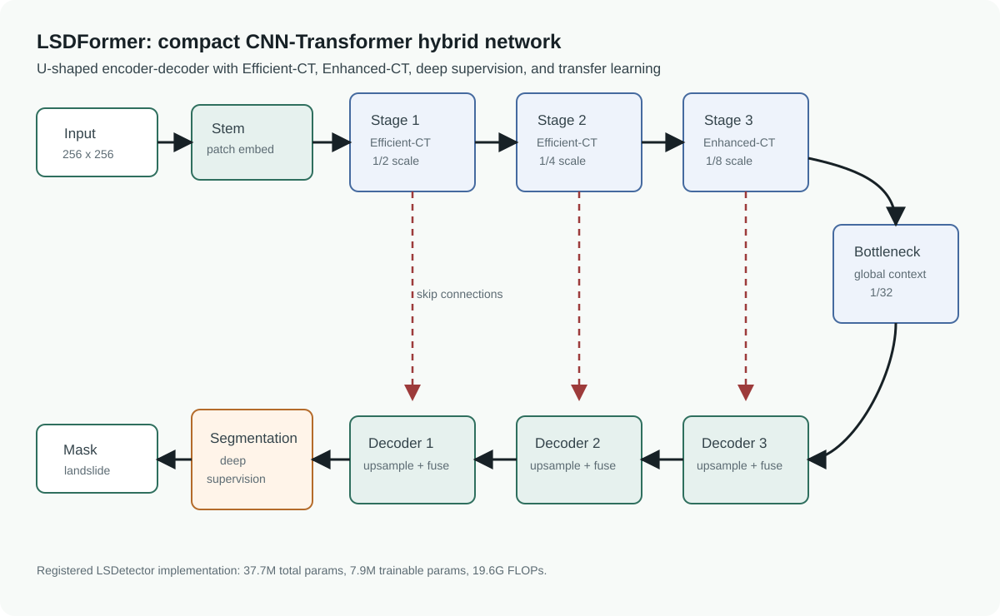
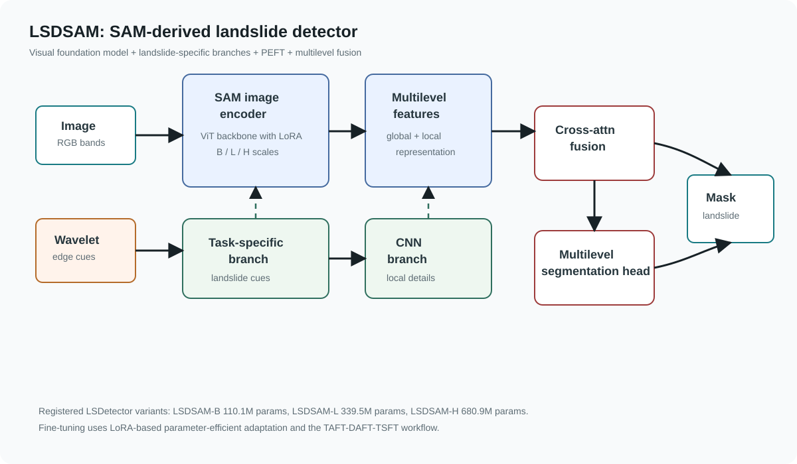

# Model Details

LSDetector integrates two complementary landslide detection model families: **LSDFormer** and **LSDSAM**. These models should be cited according to the model actually used.

## LSDFormer

**Paper:** Fu et al. (2026), *A CNN-Transformer Hybrid Network for Efficient Cross-Region Landslide Detection by Transfer Learning*, Landslides. DOI: `10.1007/s10346-026-02733-w`.

LSDFormer is designed for efficient cross-region landslide detection. It uses a compact encoder-decoder design that combines local convolutional feature extraction with global Transformer-style context modeling.

### Main Characteristics

- U-shaped semantic-segmentation architecture.
- Efficient-CT block for local-global feature extraction.
- Enhanced-CT block with spatially adaptive involution-based attention.
- Deep supervision for multi-scale segmentation learning.
- Lightweight deployment option in LSDetector.

### Reported Strengths

The LSDFormer paper reports strong cross-region performance under transfer learning. It also emphasizes efficient model complexity, with the original paper reporting about **20.0G FLOPs** and **37.7M parameters**. In the LSDetector registered implementation, LSDFormer is the fastest and lightest model family.

## LSDSAM

**Paper:** Fu et al. (2026), *LSDSAM: Harnessing Visual Foundation Model and Enhanced Transfer Learning Towards Practical Landslide Detection in Few-shot Scenarios*, IEEE Journal of Selected Topics in Applied Earth Observations and Remote Sensing.

LSDSAM adapts SAM-style visual foundation modeling to landslide detection. It is intended for practical few-shot scenarios where target-region labels are limited.

### Main Characteristics

- SAM-derived visual backbone.
- Non-prompt landslide detection architecture for remote-sensing deployment.
- Task-specific branch for edge and landslide-specific cues.
- CNN branch for local detail and boundary refinement.
- Multilevel cross-attention fusion and segmentation head.
- LoRA-based parameter-efficient fine-tuning.
- Three-stage transfer learning: TAFT, DAFT, and TSFT.

### Reported Strengths

The LSDSAM paper reports strong few-shot generalization across rainfall-induced, earthquake-induced, and complex-environment landslide datasets. In the reported 8-shot setting, LSDSAM achieves leading mIoU, IoU, and F1 performance across the tested datasets. In LSDetector, the LSDSAM family is provided at three capacity levels: B, L, and H.

## Registered LSDetector Model Complexity

| Model | Input size | Total params | Trainable params | FLOPs | Training GPU memory | Inference speed | Deployment speed |
|---|---:|---:|---:|---:|---:|---:|---:|
| LSDFormer | 256 x 256 | 37.7M | 7.9M | 19.6G | 1.0-2.9 GB | 46.4 FPS | 4.8 km2/s |
| LSDSAM-B | 512 x 512 | 110.1M | 13.5M | 261.6G | 2.6-8.4 GB | 26.1 FPS | 2.9 km2/s |
| LSDSAM-L | 512 x 512 | 339.5M | 17.4M | 840.3G | 5.3-16.3 GB | 18.6 FPS | 2.1 km2/s |
| LSDSAM-H | 512 x 512 | 680.9M | 21.6M | 1704.4G | 8.4-25.0 GB | 11.2 FPS | 1.6 km2/s |

## Model Selection

| Need | Recommended model |
|---|---|
| Fast screening or limited GPU memory | LSDFormer |
| Balanced foundation-model performance | LSDSAM-B |
| Higher-capacity mapping with moderate resources | LSDSAM-L |
| Best available LSDetector benchmark and Wuping deployment setting | LSDSAM-H |

## Citation Rule

- Use the LSDFormer citation when using LSDFormer or its weights.
- Use the LSDSAM citation when using LSDSAM-B/L/H, SAM-derived adapters, or the LSDSAM transfer-learning workflow.
- Use both citations when comparing, combining, or reporting LSDetector as a platform containing both model families.
