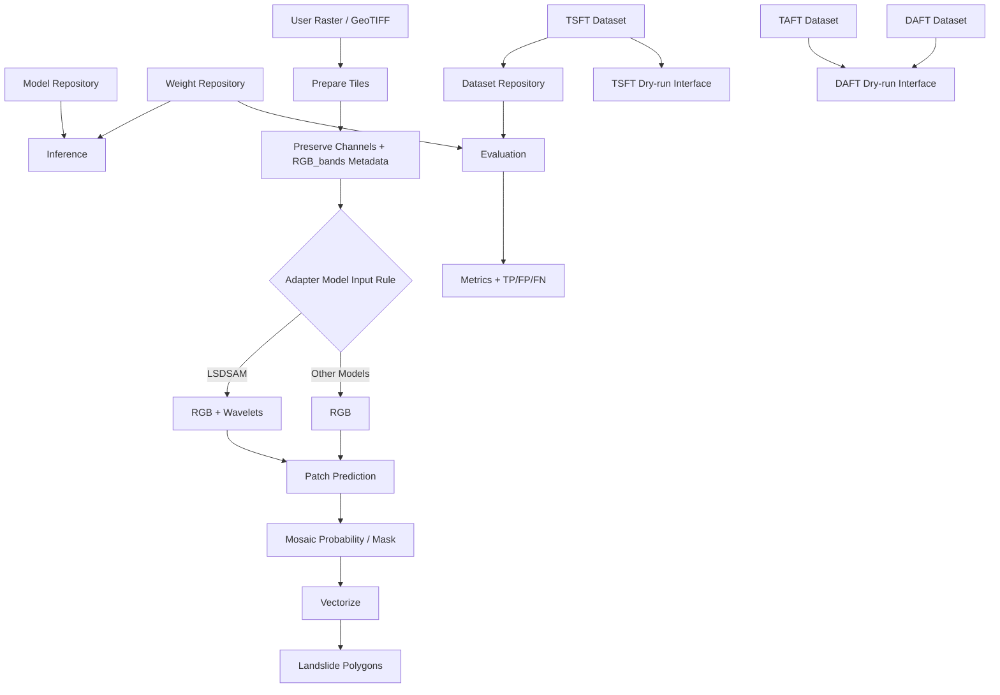

# LSD_APP Architecture Plan

## Workbench Modules

LSD_APP is organized as a local landslide-mapping workbench:

1. Model Repository: Net/Adapter metadata.
2. Weight Repository: TAFT/DAFT/TSFT/inference-ready checkpoints linked to models.
3. Dataset Repository: TAFT, DAFT, and TSFT datasets with local paths and GT metadata.
4. DAFT Training: reserved dry-run interface.
5. TSFT Training: reserved dry-run interface.
6. Inference: deployment-only raster-to-polygon pipeline.
7. Evaluation: independent GT-based benchmark workflow.

## Repository Contracts

Model rows expose:

```text
model_id, net_name, adapter, model_family, input_mode, channel_rule, status, description
```

Weight rows expose:

```text
weight_id, model_id, stage, version, path, exists, created_at, metrics_summary, notes
```

Dataset rows expose:

```text
dataset_id, dataset_class, name, imagery_path, label_path, has_gt, RGB_bands, RGB_bands_class, tile_schema, source, created_at, notes
```

Dataset classes:

- `TAFT`: pretraining data.
- `DAFT`: domain-adaptation and benchmark data.
- `TSFT`: user few-shot training data.

## Model Input Rules

- LSDSAM always uses `rgb_wavelets`; its edge branch is fixed to `wavelets`.
- Other models use `rgb`.
- Input data must declare `RGB_bands: R,G,B`, where R/G/B are 1-based source GeoTIFF band indexes. Common presets are `RGB_bands: 1,2,3`, `RGB_bands: 3,2,1`, `RGB_bands: 4,3,2`, and `RGB_bands: 6,4,2`.
- `lsd_app/core/channels.py` is the single source of truth for channel semantics. Dataset storage preserves all original bands; adapters consume `RGB_bands` to extract the model-visible RGB triplet.
- LSDSAM applies ImageNet RGB normalization with `mean=(0.485, 0.456, 0.406)` and `std=(0.229, 0.224, 0.225)` inside `lsd_app/models/lsdsam.py`.

## Data Flow



## Deployment Versus Evaluation

Deployment ends at `landslides.gpkg` / `landslides.geojson` plus overlay visualization. Evaluation is separate and requires a registered dataset with `has_gt=true`.

## Legacy Augmentation Mapping

`LSDSAM_finetune/dataloader_SAM.py::CustomDataset` remains a legacy reference. Its random Albumentations pipeline is training-only and is mapped into `lsd_app/training/augmentations.py` as `legacy-lsdsam-train-v1`:

- Train: resize/pad, horizontal flip, vertical flip, random resized crop, rotate, Gaussian noise, Gaussian blur, random brightness/contrast.
- Eval/test: resize/pad only.
- Post transform: wavelets for LSDSAM, ImageNet normalization for RGB, tensor conversion.

The profile is attached to TAFT/DAFT/TSFT dry-run plans. It is not called by inference or evaluation, because those paths must be deterministic.
