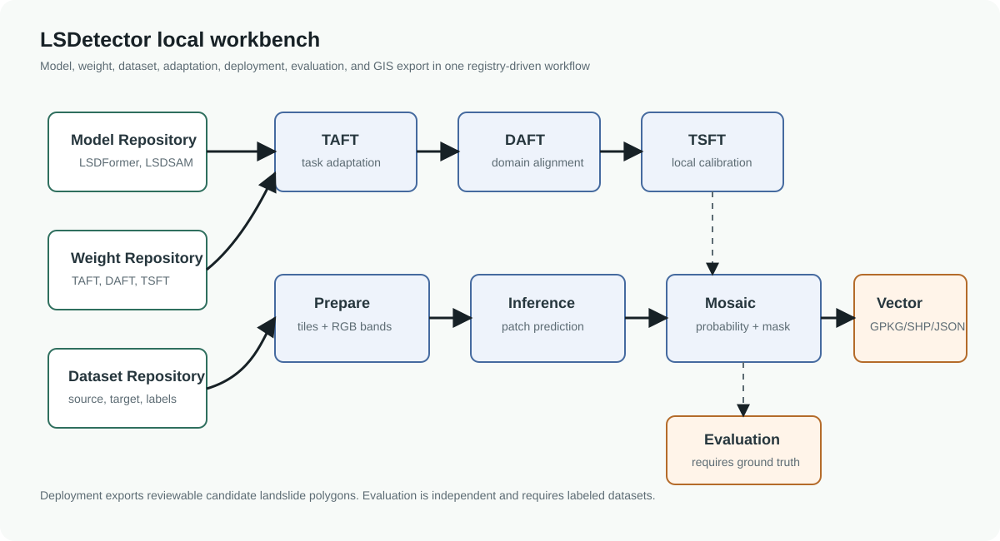
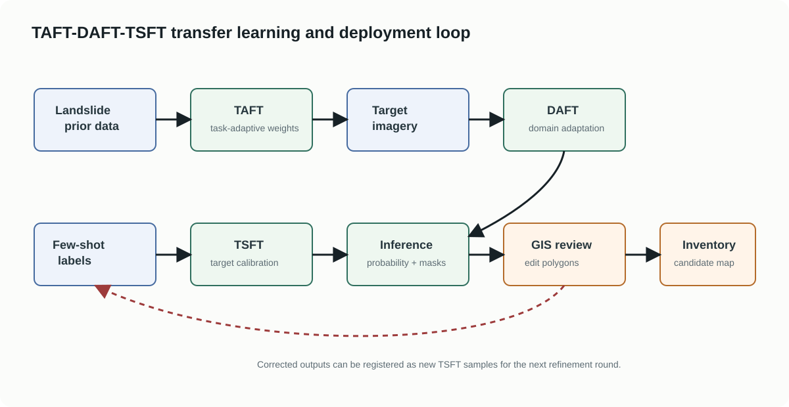
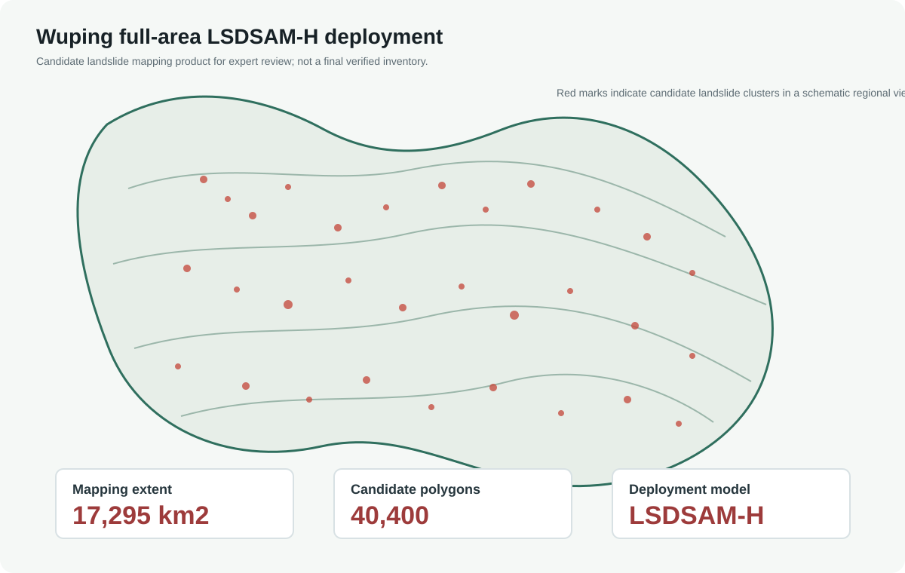

# Wuping Deployment Case

This page summarizes the LSDetector practical deployment case prepared for the ISGDR software paper. It intentionally focuses on software architecture, model-assisted workflow, and regional mapping output. It does **not** reproduce the ISGDR precision-evaluation tables.

## Study Context

The Wuping demonstration area is a rainfall-triggered landslide region in southeastern China. The target deployment used post-event PlanetScope imagery and followed the LSDetector three-stage transfer-learning workflow.

## Software Architecture

LSDetector connects model assets, weight assets, data assets, adaptation, inference, evaluation, and GIS-compatible output in a local workbench.

## Iterative AI-assisted Mapping

The Wuping deployment followed an iterative procedure:

1. Start from a limited number of manually labeled local samples.
2. Run target-specific fine-tuning.
3. Deploy the model to a larger region.
4. Correct false positives, missed landslides, and boundary errors in external GIS software.
5. Register corrected samples as a new TSFT dataset.
6. Repeat refinement and deployment.

## Regional Deployment Result

The ISGDR demonstration used **LSDSAM-H** for large-area deployment. The final deployment covered **17,295 km2** of PlanetScope imagery and generated **40,400 candidate landslide polygons** across the Wuping region.

## Interpretation Notice

The Wuping polygons are candidate landslide products for review. They demonstrate the practical mapping ability of LSDetector, but they should not be treated as a fully verified landslide inventory without expert checking or additional refinement rounds.
